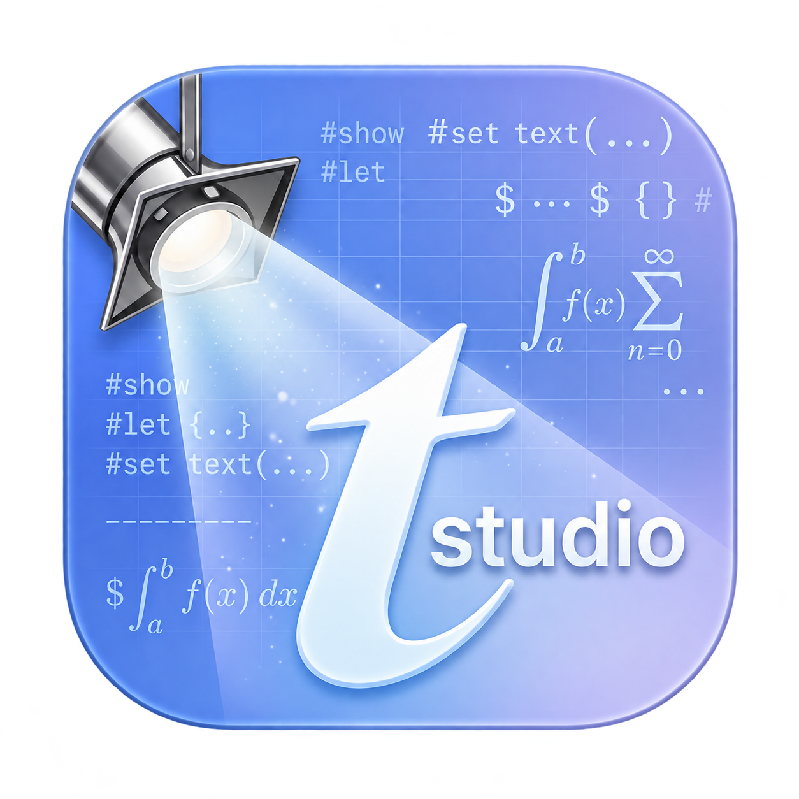
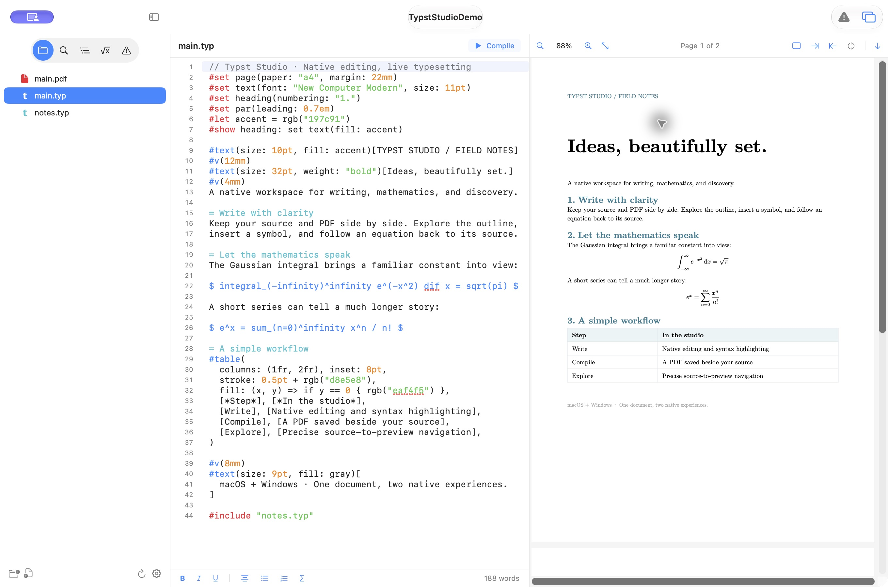
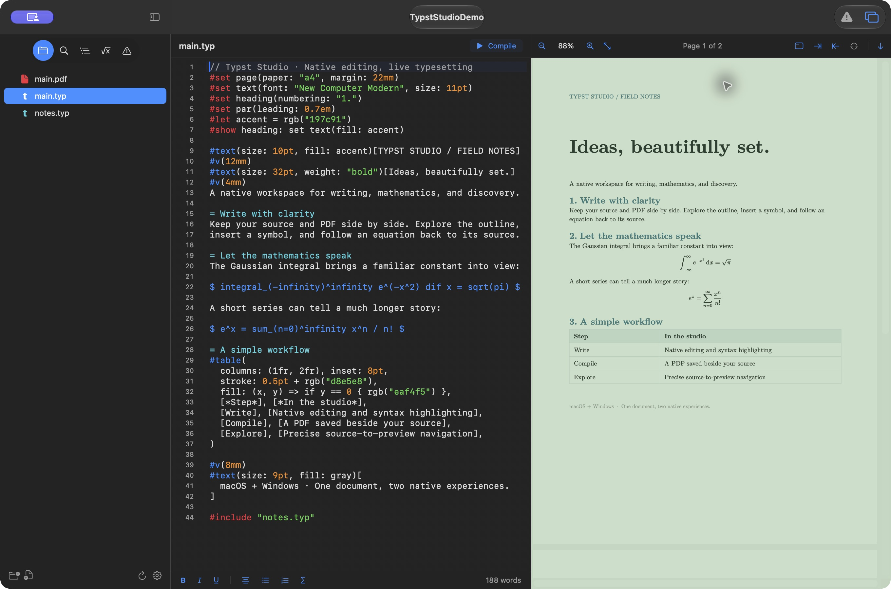
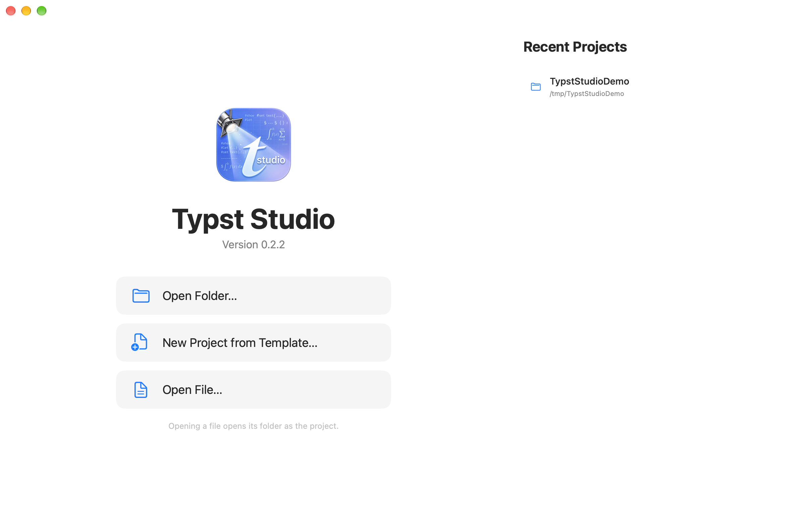
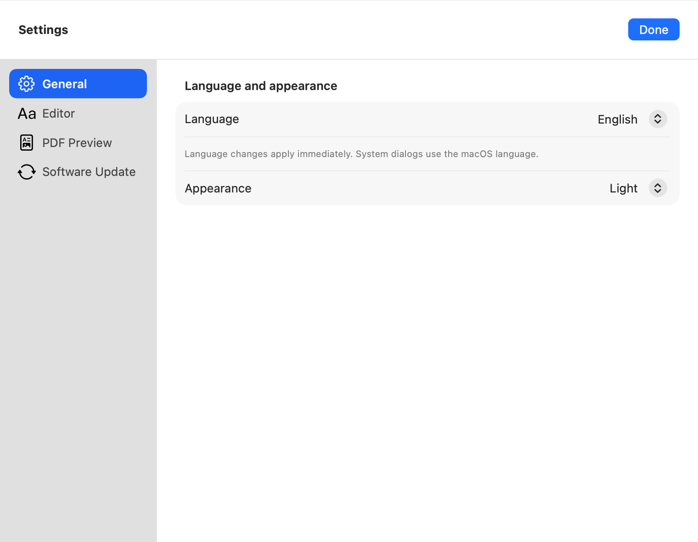
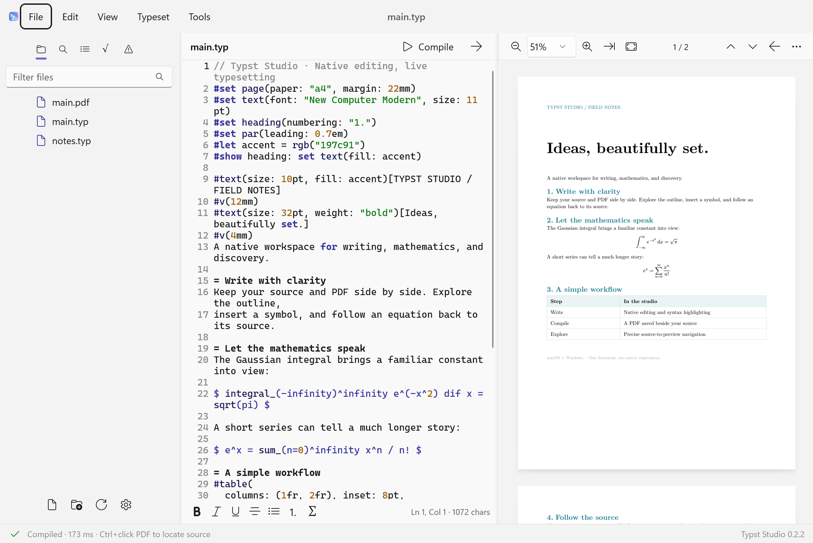
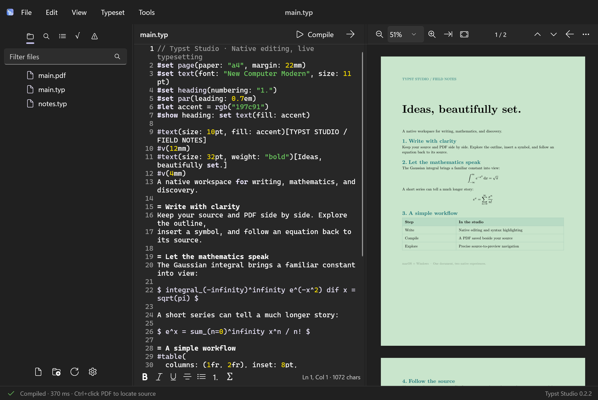
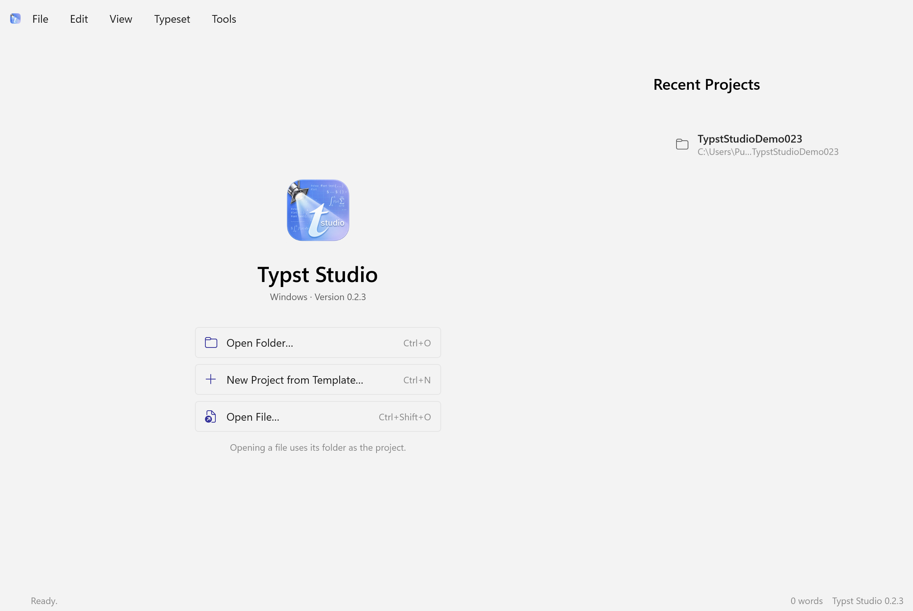
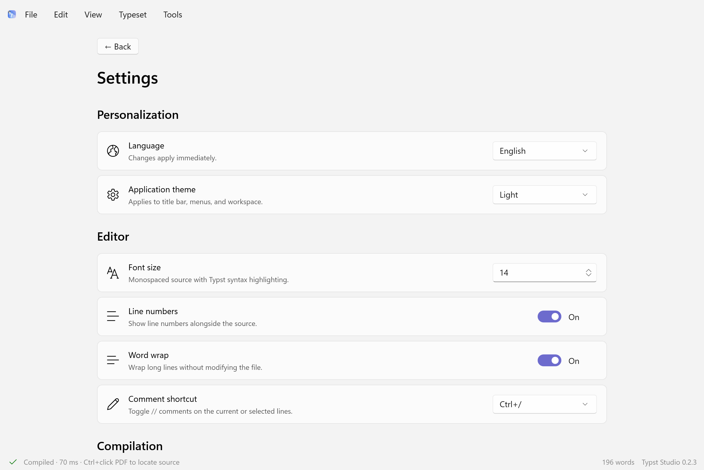

<p align="center"></p>

# Typst Studio

**A native Typst editor for macOS and Windows.** Write, compile, preview, and navigate scientific documents in a desktop interface built for each platform.

[简体中文](README_CN.md) · [Download](https://github.com/liaoweiyang2017/typst-studio/releases/latest) · [Release notes](docs/Release-0.2.2.md) · [Contributing](CONTRIBUTING.md)


## Highlights

- **Two native interfaces.** SwiftUI, AppKit and PDFKit on macOS; WinUI 3 and Fluent controls on Windows. No embedded browser editor.
- **Persistent Typst compilation.** Bundled Tinymist processes reuse compiler state. Edit included files while keeping the main-document preview active.
- **An explicit Compile command.** Browsing files and inverse navigation do not change the preview entry. Compile the current editor to select a different entry.
- **PDFs beside their sources.** A successful compile writes `main.pdf` next to `main.typ`, including automatic updates. Writes use the original PDF bytes, not the reading-mode colors.
- **Compiler-backed source mapping.** Navigate between source and PDF text or formulas, including across project files.
- **A practical workspace.** Project tree, project search, expanded document outline, math symbols, diagnostics, resizable editor/preview panes, and syntax highlighting.
- **Comfortable reading.** Original, night and soft-green PDF modes; light/dark application themes; English and Simplified Chinese interfaces.
- **Background updates.** Check on launch, download and verify without blocking editing, then install and restart when you are ready. Unsaved documents are handled before closing.

## Download and install

| Platform | Requirements | Installer |
| --- | --- | --- |
| macOS | Apple Silicon, macOS 14 or later | [ARM64 DMG](https://github.com/liaoweiyang2017/typst-studio/releases/download/v0.2.2/Typst-Studio-0.2.2-macOS-arm64.dmg) |
| Windows ARM64 | Windows 10 build 19041 or later; Windows 11 recommended | [ARM64 Setup](https://github.com/liaoweiyang2017/typst-studio/releases/download/v0.2.2/Typst-Studio-0.2.2-Windows-arm64-Setup.exe) |
| Windows x64 | Intel/AMD Windows 10 build 19041 or later; Windows 11 recommended | [x64 Setup](https://github.com/liaoweiyang2017/typst-studio/releases/download/v0.2.2/Typst-Studio-0.2.2-Windows-x64-Setup.exe) |

On macOS, drag the application to Applications. On Windows, run Setup; choose English or Simplified Chinese and whether to create a desktop shortcut. The Windows installer is per-user and includes its .NET/WinUI runtime.

The Typst compiler is bundled; users do not need Rust, Python, a terminal, or a separate compiler installation. New `@preview` package imports may need internet access or an existing Typst package cache. Fonts come from the bundled compiler and your system; install any additional fonts your document requests.

The current Mac distribution uses an ad-hoc signature and is not Developer ID notarized. Windows installers are not Authenticode-signed. Download only from this repository's Release pages. In-app updates additionally verify developer signatures.

## Screenshots

### macOS

**Light interface · original white PDF**



**Dark interface · soft green PDF**



<details><summary>Welcome and settings</summary>




</details>

### Windows

**Light interface · original white PDF**



**Dark interface · soft green PDF**



<details><summary>Welcome and settings</summary>




</details>

Screenshots show the included [showcase project](examples/showcase), rendered by the native applications. They do not contain private documents.

## Examples

Start with [basic text](examples/hello.typ), [mathematics](examples/math.typ), [tables](examples/table.typ), or [a multi-file document](examples/multi-file/main.typ). See the [example guide](examples/README.md). No external packages are required.

## Getting started

1. Open a project folder, an existing `.typ` file, or a template from the welcome page.
2. Select the intended entry, usually `main.typ`, and choose **Compile**.
3. Edit the entry or an included chapter. Automatic compilation updates that entry; Windows also offers an automatic-compilation switch.
4. Use source mapping to move between code and the PDF. Browsing another file does not recompile it as a standalone document.
5. To compile a different file independently, open it and choose **Compile** again.

A successful compilation updates `<entry-name>.pdf` in the same directory. The PDF reflects the current in-memory compilation, including unsaved edits; the application does **not** silently save `.typ` sources. Existing same-name PDFs are treated as build outputs and replaced. Failed compilation leaves the previous PDF intact. Unnamed documents need a source path before an adjacent PDF can be written. If a directory is not writable or an output is locked, the preview remains available and the application reports the write failure.

Use **Export PDF** for a separate destination. Night/green display modes never recolor saved PDFs.

### Shortcuts

| Action | macOS | Windows |
| --- | --- | --- |
| Compile current editor | ⌘B | Ctrl+B |
| Save source | ⌘S | Ctrl+S |
| Open file | ⌘O | Ctrl+Shift+O |
| Open folder | ⇧⌘O | Ctrl+O |
| Find | ⌘F | Ctrl+F |
| Source → PDF | ⇧⌘J | Ctrl+Shift+J |
| PDF selection → source | ⌥⌘J | Ctrl+Alt+J |
| PDF glyph → source | ⌘-click | Ctrl-click |
| Toggle line comment | — | Ctrl+/; configurable |
| Toggle sidebar | Toolbar button | Ctrl+Shift+B or toolbar |

## Updates

Both applications check once after launch by default. This can be turned off in Settings; a manual check is also available. Downloads and signature verification run in the background. A prepared update waits for **Install and restart**, with save/discard/cancel handling before closing.

Mac uses Sparkle. Windows uses NetSparkle core with a native WinUI interface and the existing Inno installer. Platform-specific signed feeds and packages are hosted in the **same main repository Release**; Windows ARM64 and x64 do not exchange packages. A canceled, invalid or failed update must not silently terminate the editor.

**Migration from 0.2.1 and earlier:** install 0.2.2 manually once. The former distribution repository is being retired, so its old Mac update URL is no longer the update channel; earlier Windows versions did not include an updater. Future updates use this main repository.

See [local release workflow](docs/RELEASING.md). No GitHub Actions are used to build or publish releases.

## Repository layout

```text
typst-studio/
├── macOS/          # Swift package, native UI, resources, tests, build scripts
├── Windows/        # WinUI application, C# core, tests, installer, dependencies
├── examples/       # Small, redistributable Typst demo projects
├── docs/           # Screenshots, release notes and developer documentation
├── scripts/        # Shared signing, verification and publication tools
├── vendor/         # Pinned Tinymist patch and provenance
└── LICENSE         # MIT license for this project's own code
```

### Build macOS

Requires an Apple Silicon Mac, Xcode command-line tools, Swift, and a local Typst binary. The first Tinymist build additionally needs Rust 1.92+ and network access for pinned dependencies.

```sh
bash macOS/scripts/test.sh
APP_DESTINATION="/tmp/Typst Studio.app" bash macOS/scripts/build-app.sh
APP_DESTINATION="/tmp/Typst Studio.app" bash macOS/scripts/package-dmg.sh
```

Set `TYPST_BIN` or `TINYMIST_BIN` only when supplying development binaries. Keep app-bundle staging outside cloud-synced folders. The DMG and ZIP are written to `dist/`; release-signing keys are not needed for an ordinary local build.

### Build Windows

Requires Windows, .NET 10 SDK, Visual Studio C++ build tools, Rust/LLVM for the first native helper build, and Inno Setup. Follow [Windows build instructions](Windows/README.md) for pinned native binaries and checksums.

```bat
cd Windows
tools\test.cmd
tools\build.cmd
```

Pass `arm64` or `x64` to restrict the target. Use `installer\TypstStudio.iss` with `SourceDirectory` and `TargetArchitecture` to package. `tools\package.cmd` is the local VM convenience wrapper and its paths may need adjustment.

## Scope and known limitations

- Source mapping needs a successful current compile and a rendered compiler span. Unrendered syntax and some generated graphics have no location; the editor does not guess a nearby source.
- External package sources are not silently opened as project files. A macro can produce several rendered locations for one source span.
- Platform features are not identical: macOS provides native spell checking and a detached PDF window; Windows provides configurable line-comment shortcuts and line-number visibility. Windows currently clears the visible editor's undo history on file switches.
- Windows x64 has been tested under Windows ARM emulation; that is not a substitute for testing every physical x64 device. Detailed validation is recorded in the versioned specs.

## Contributing and license

See [CONTRIBUTING.md](CONTRIBUTING.md) and [SECURITY.md](SECURITY.md). Keep native UI conventions, file safety, background responsiveness, and source-mapping regression coverage intact.

Typst Studio's own code is available under the [MIT license](LICENSE). Bundled dependencies retain their own licenses: [Mac notices](macOS/Resources/THIRD_PARTY_NOTICES.txt), [Windows notices](Windows/licenses/THIRD-PARTY-NOTICES.txt), and [Tinymist patch provenance](vendor/README.md).

Typst Studio is an independent project and is not an official product of Typst, TeXstudio, or Edist.
